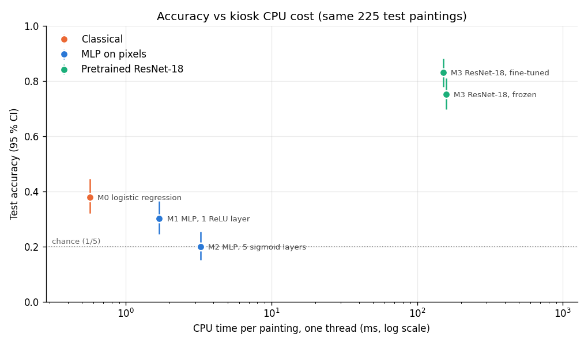

# Museum AI Guide

Classify WikiArt paintings into Baroque, Cubism, Impressionism, Pop Art and Ukiyo-e.
The supplied dataset contains 300 images per class (1,500 total), cropped to 128 pixels.

## Corrected experiments

Run commands from this repository using Python 3.13:

```powershell
py -3.13 -m venv .venv
.venv\Scripts\python -m pip install -r requirements.txt
.venv\Scripts\python experiments.py --split-only
.venv\Scripts\python train_m0.py
.venv\Scripts\python train_m1.py
.venv\Scripts\python train_m2.py
.venv\Scripts\python train_m3.py
.venv\Scripts\python experiments.py --model m3_frozen
.venv\Scripts\python -m unittest -v test_experiments
```

CPU is the default. Full ResNet fine-tuning can take substantial time. Use `--epochs 1`
for an initial smoke run, and `--device cuda` only when CUDA is available.
If the Python launcher is unavailable, create the environment with
`& "$env:LocalAppData\Programs\Python\Python313\python.exe" -m venv .venv` in PowerShell.
CPU threads default to two and can be changed with `--threads`.

In Git Bash, activate the same environment with `source .venv/Scripts/activate`,
then use `python` for the commands above (for example, `python train_m1.py`).
Check `python --version` reports Python 3.13 before installing or training.
Pretrained ResNet weights require a first-time download.
`requirements-lock.txt` records the exact packages installed in the Windows Python 3.13
environment. Use `python -m pip install -r requirements-lock.txt` to reproduce those versions.

All models use the same saved, stratified 70/15/15 split in `splits/style5.json`
(1,050 training, 225 validation, 225 test images). It records relative image paths,
class names, a path fingerprint and the split seed. Reusing it is mandatory for comparison;
changing the training seed does not regenerate an existing split. The fingerprint checks
the image inventory, not image contents. This is an image-level split: artists may occur
in multiple partitions, so it does not measure generalization to unseen artists.

| Model | Approach | Input |
| --- | --- | --- |
| M0 | scikit-learn logistic regression; C selected using validation accuracy | 64 x 64 RGB, flattened, values in [0,1] |
| M1 | 256-unit ReLU MLP | 64 x 64 RGB, values in [0,1] |
| M2 | Five sigmoid layers, dropout 0.3; original learning rate retained for diagnosis | 64 x 64 RGB, values in [0,1] |
| M3 | ImageNet ResNet-18; all layers fine-tuned | pretrained weights' resize/crop/normalization |
| M3 frozen | ResNet backbone and batch-normalization statistics frozen; classifier trained | same as M3 |

M1/M2 now use 64-pixel inputs to reduce CPU cost. ResNet preprocessing produces
224-pixel inputs; upscaling the supplied 128-pixel images cannot restore lost detail.
M2 retains sigmoid deliberately: stagnant loss is a hypothesis to investigate, not
proof of vanishing gradients. `gradients.json` records mean per-batch weight-gradient
L2 norms for every layer each epoch. Layer widths affect these norms too.

Each execution creates a unique `runs/<model>_<timestamp>/` directory containing:

- `config.json` and the exact `split.json` used.
- Neural models: `history.json`, `curves.png`, and `best.pt`, selected by validation loss.
- M2: `gradients.json` and `gradients.png`; M0: `selection.json` and `best.joblib`.
- `test_metrics.json`: accuracy, macro F1, confusion matrix (rows=true, columns=predicted),
  and total experiment duration. Duration is not inference latency.
- `test_predictions.csv`: individual test paths and predictions for error analysis.
- `confusion_matrix.png`: a visual version of the test confusion matrix.

The test set is evaluated after model selection. Do not tune settings against test scores.
Accuracy values are fractions, not percentages. Saved neural checkpoints include class
order and architecture identifier. Do not load untrusted pickle/joblib model files.

## CPU benchmark and recommendation to the director

`python benchmark.py` takes the latest completed run of every model, times it on **one painting at a time and one
CPU thread** (the model's own preprocessing included, 60 test paintings, median and 90th percentile), measures its
serialised size, and computes 95 % bootstrap intervals from `test_predictions.csv`. Measured on a laptop AMD CPU
(8 logical cores, 1 used); results in `runs/benchmark_1793358411979475300/`.

| Model | Test accuracy [95 % CI] | Macro F1 | CPU time / painting (p90) | Size | Run |
| --- | --- | ---: | ---: | ---: | --- |
| M2 MLP, 5 sigmoid layers | 0.200 [0.151, 0.253] | 0.067 | 3.3 ms (4.5) | 25.9 MB | `m2_1793300452973140000` |
| M1 MLP, 1 ReLU layer | 0.302 [0.244, 0.364] | 0.257 | 1.7 ms (1.8) | 12.6 MB | `m1_1793299518786019100` |
| M0 logistic regression (pixels) | 0.378 [0.320, 0.444] | 0.372 | 0.6 ms (0.8) | 0.5 MB | `m0_1793355775110682900` |
| M3 ResNet-18, frozen backbone | 0.751 [0.698, 0.809] | 0.749 | 158 ms (185) | 44.8 MB | `m3_frozen_1793300573210941500` |
| **M3 ResNet-18, fine-tuned** | **0.831 [0.778, 0.880]** | **0.830** | **151 ms (202)** | **44.8 MB** | `m3_1793355952561843000` |



Both M3 variants have the same architecture, so the same inference cost (the 7 ms gap is timing noise); M1, M2 and
M3 frozen were timed with their exact architecture because their weights are not on the benchmarking computer.

**Recommendation: a neural network is worth it, but a pretrained one.**

1. **Do not deploy an MLP trained on pixels.** M1 (0.30) does not beat a plain logistic regression on the same
   pixels (0.38), and M2 predicts a single style (see [DIAGNOSIS.md](DIAGNOSIS.md) on the diagnosis branch). Both
   are wrong on most paintings.
2. **Deploy the fine-tuned ResNet-18 (M3):** 0.83 test accuracy, more than twice the classical model, with
   non-overlapping confidence intervals. It answers in about 0.15 s per painting on a single CPU thread and takes
   45 MB: no GPU and no cloud service, so no recurring cost on a modest kiosk.
3. **Keep the frozen ResNet-18 (0.75) as the low-maintenance option:** same inference cost, and only its last
   layer (2,565 parameters) has to be retrained when the collection changes. Fine-tuning adds about 8 points (the
   intervals barely overlap) for 40 minutes of CPU training, done once.

**Limits:** 225 test paintings (about +-6 points on each accuracy); WikiArt scans rather than visitors' photos
(reflections, perspective, frames), to be tested before deployment; latency measured on one laptop CPU, to be
measured again on the kiosk; the split is per image and 89 % of the test paintings are by "Unknown Artist", so
the ResNet may partly recognise painters rather than styles and its scores may be optimistic.

## Legacy artifacts

The existing `models/*.pth` and sigmoid curve come from the original training scripts.
They are retained for reference and are incompatible with the new MLP input dimensions.
M1 originally trained on every image, so those weights must not be evaluated as an
independent held-out baseline. Original M2/M3 splits were not saved. Retrain before
reporting a fair comparison. No new performance claims are made by these code changes.

## Dataset reproduction

```powershell
python make_wikiart_subset.py --label style --classes Impressionism Baroque Cubism Ukiyo_e Pop_Art --per-class 300 --size 128 --out data/wikiart_style5
```

See `data/wikiart_style5/subset_info.json` for the pinned source revision and settings.
The dataset builder documents image rights and coursework usage restrictions.

## Remaining delivery work

Run and inspect corrected experiments, investigate M2 gradients, benchmark CPU inference
latency/RAM/model size, and write a measured comparison. Frozen ResNet feature caching,
inference for uploaded images, visual/text retrieval, and a Streamlit guide remain future
work. No museum interface or deployment benchmark is implemented yet.

## Saving completed work

See [RESULTS.md](RESULTS.md) for measured results and run completion status.
Small reports in `runs/` are tracked by Git; checkpoint files remain excluded.
Run `python backup_progress.py` after training to create and verify a local ZIP with
source files, settings, splits, reports and trained run weights. Copy the resulting ZIP
and checksum from `backups/` to independent storage. Neither `.venv/` nor dataset images
are included in that ZIP; dependency versions are in `requirements-lock.txt`.
